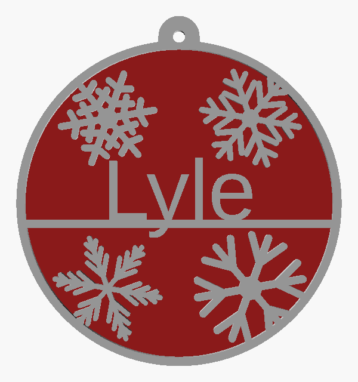
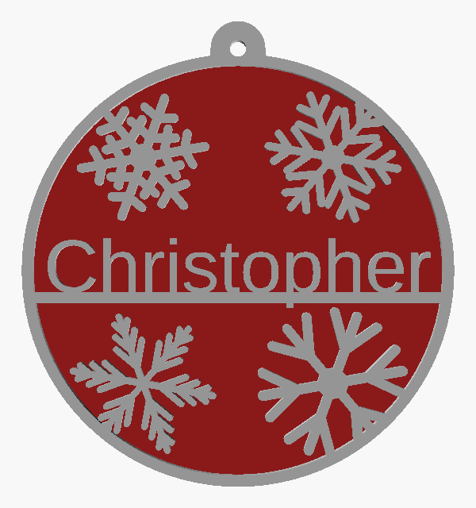

# Christmas Name Ornament

A flat, 79 mm Christmas ball ornament with a name across it, up to four
snowflakes, and an optional second line of text, made in OpenSCAD. Every part
can be exported on its own for printing in two or more colours.

A long name is scaled down to fit inside the ball, and the presets export in
one batch with [scadbatch](https://github.com/CameronBrooks11/scadbatch).



## Use it

Open `src/ChristmasNameOrnament.scad` in [OpenSCAD](https://openscad.org) and
set the parameters in the Customizer panel:

- **Name** and **font**, the font size, and whether there is a line under the
  name.
- **Snowflakes:** one of six designs, or none, in each of four places.
- **Background thickness:** the red disc behind the details. Zero leaves it out.
- **Second line of text**, such as a year. You'll usually have to move it with
  its X and Y offsets.
- **Part:** the ball outline, the name, the second line, the snowflakes, the
  background, or everything.

The Customizer also lists the five example presets in
`src/ChristmasNameOrnament.json`, which OpenSCAD loads because it has the same
name as the `.scad` file.

### Long names

A name wider than `name_max_width` (70 mm by default) is scaled down to that
width, keeping its proportions. At the default size of 15, "Christopher" in
Liberation Sans is 106 mm wide and would hang outside the ball; here it's
scaled to 70 mm:



Set `name_max_width` to 0 to leave the name at full size. Fitting needs an
OpenSCAD version with `textmetrics()`. OpenSCAD 2021.01 doesn't have it: there
it warns `Ignoring unknown function 'textmetrics'` and leaves the name at full
size.

### Fonts

The font list offers Arial Black and Arial Bold Italic, and seven
[Google Fonts](https://fonts.google.com): Berkshire Swash, Courgette, Sriracha,
Yellowtail, Tangerine, Parisienne and Italianno. Choose "other" to name any
installed font, in the form `Nunito Sans:style=Bold Italic`. Help > Font List
in OpenSCAD shows what's installed. Restart OpenSCAD after installing a font.

**If a font isn't installed, OpenSCAD uses another one without a warning.**
Check the preview before exporting.

### Several colours

Export each part (outline, name, second line, snowflakes, background) as its
own STL, load them together in the slicer, and give each a filament or an
extruder. With one nozzle, print the background in one colour and change
filament for the rest. A small cylinder placed in the slicer gives the nozzle
somewhere to prime after the change.

If there's no background, or no second line, exporting that part gives a
0.01 mm placeholder instead of an empty file. It sits inside the ring.

### Batch export

[scadbatch](https://github.com/CameronBrooks11/scadbatch) exports every preset
in one run:

```sh
scadbatch export src/ChristmasNameOrnament.scad src/ChristmasNameOrnament.json out/
```

Add your own names as presets in the JSON, or save them from the Customizer.

## Printing

- The ornament prints flat. At the defaults it's 2 mm thick: a 0.4 mm
  background and 1.6 mm details.
- In Cura, **Skin Expand Distance** keeps the top layers of thin details
  continuous; other slicers have an equivalent setting.
- To print a different size, scale it in the slicer.

## Known limits

- **With no background, the ring and the underline hold everything together.**
  The underline stays on when there's no background, whatever
  `line_under_name` says. Each snowflake reaches the ring from every position.
  The dot of an `i` or a `j` doesn't reach anything, so it prints as a loose
  piece: "Liam" in Liberation Sans comes out as two pieces.
- **The second line is placed by hand.** Nothing keeps it inside the ball or
  off the snowflakes.

## Checks

`just test` takes about 4 s. For 17 cases and the 5 presets, it renders the
ornament with warnings treated as errors, then checks how many separate solids
it has and its size. The cases cover each part, a long name with and without
fitting, and no background with each snowflake in every position. They use
Liberation Sans, which has to be installed (`fonts-liberation` on Debian), and
were written against OpenSCAD 2026.10.15.

`just images` renders the two pictures in this README.

## Origin and licence

The ornament is a rewrite, under MIT, of an idea from Lyl3's
[Christmas Name Ornament](https://www.thingiverse.com/thing:4681765) on
Thingiverse: a name across a flat ball ornament, with snowflakes. The code, the
ball outline and the six snowflakes, drawn by one generator, are new; the
parameters and presets keep their names, so saved presets still load. The
earlier CC BY-SA 3.0 versions are in this repository's history. MIT; see
[LICENSE](LICENSE).
